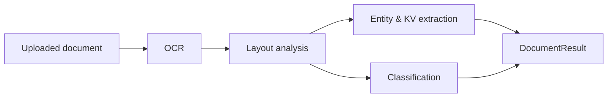

# document-intelligence-ai

Turn PDFs and images into structured data — OCR, layout analysis, entity &
key-value extraction, and document classification, served over a FastAPI API.

[](LICENSE)
[](https://github.com/abhisheksawant52/document-intelligence-ai/actions/workflows/ci.yml)
[](https://www.python.org/)
[](https://fastapi.tiangolo.com/)
[](https://www.terraform.io/)

## Overview

`document-intelligence-ai` ingests documents (PDFs, scanned images), runs them
through a processing pipeline, and returns structured results: recognized text
with bounding boxes, layout blocks, extracted entities and key-value pairs, and
a predicted document type (invoice, contract, resume, receipt, report).

The pipeline stages are cleanly separated. Layout analysis, extraction, and
classification depend only on the Python standard library, so they always work
and are easy to test. OCR is pluggable: a Tesseract-backed engine is used in
production, while a deterministic, dependency-free fallback engine keeps the
service runnable in any environment.

## Architecture



Components:

- **OCR** (`ocr.py`) — pluggable `OCREngine`; Tesseract engine + deterministic
  fallback that returns text and positioned tokens.
- **Layout analysis** (`layout.py`) — groups tokens into lines/blocks using
  pure geometry over bounding boxes.
- **Extraction** (`extraction.py`) — regex/heuristic extraction of dates,
  amounts, emails, phone numbers, invoice numbers, and key-value pairs.
- **Classification** (`classification.py`) — keyword-scoring classifier that
  returns a label and normalized confidence.
- **Pipeline** (`pipeline.py`) — `DocumentPipeline` orchestrating the stages.
- **API** (`main.py`) — FastAPI app exposing the endpoints on port 8000.

## Features

- Full document pipeline: OCR → layout → extraction → classification.
- REST API with per-stage endpoints (`/ocr`, `/extract`, `/classify`) plus a
  full `/process` endpoint.
- Bounding-box-aware layout grouping.
- Entity extraction for dates, monetary amounts, emails, phone numbers, and
  invoice numbers, plus labelled key-value pairs.
- Heuristic document classification with a transparent score distribution.
- Dependency-free core so tests and local runs need no OCR system packages.
- Container image and Terraform infrastructure for AWS deployment.

## Tech Stack

Python 3.11+ · FastAPI · Uvicorn · Pydantic · pydantic-settings · pytesseract
(optional) · pytest · ruff · black · Docker · Terraform (AWS) · GitHub Actions

## Getting Started

### Prerequisites

- Python 3.11 or newer
- `make` (optional, for convenience targets)

### Install

```bash
python -m venv .venv && source .venv/bin/activate
make install            # pip install -e ".[dev]"
cp .env.example .env    # adjust DOCAI_* values as needed
```

### Run

```bash
uvicorn document_intelligence.main:app --host 0.0.0.0 --port 8000
```

The interactive API docs are then available at
[http://localhost:8000/docs](http://localhost:8000/docs).

### Try it

```bash
# Create a sample invoice-like document
cat > sample.txt <<'EOF'
INVOICE
Invoice Number: INV-2024-0042
Date: 2026-07-08
Bill To: Acme Corp
Total: $1,250.00
EOF

# Run the full pipeline
curl -s -X POST http://localhost:8000/process \
  -F "file=@sample.txt" | python -m json.tool
```

## Project Structure

```
.
├── src/document_intelligence/   # application package
│   ├── main.py                  # FastAPI app + endpoints
│   ├── config.py                # DOCAI_* settings
│   ├── logging_config.py        # logging setup
│   ├── models.py                # pydantic models
│   ├── ocr.py                   # OCR engine abstraction + fallback
│   ├── layout.py                # geometric layout analysis
│   ├── extraction.py            # entity & key-value extraction
│   ├── classification.py        # document type classification
│   └── pipeline.py              # end-to-end orchestration
├── infra/terraform/             # AWS infrastructure (IaC)
│   ├── main.tf, variables.tf, outputs.tf, versions.tf, providers.tf
│   ├── modules/storage/         # DynamoDB results table module
│   └── environments/            # dev/ and prod/ tfvars
├── tests/                       # pytest suite
├── docs/architecture.md         # architecture notes
├── Dockerfile                   # multi-stage, non-root image
└── .github/workflows/ci.yml     # CI pipeline
```

## Configuration

All settings are environment variables with the `DOCAI_` prefix (see
`.env.example`).

| Variable                     | Default                    | Description                                   |
| ---------------------------- | -------------------------- | --------------------------------------------- |
| `DOCAI_APP_NAME`             | `document-intelligence-ai` | Service name reported by the API.             |
| `DOCAI_ENVIRONMENT`          | `development`              | Environment label.                            |
| `DOCAI_LOG_LEVEL`            | `INFO`                     | Logging verbosity.                            |
| `DOCAI_OCR_ENGINE`           | `tesseract`                | OCR engine (`tesseract` or `fallback`).       |
| `DOCAI_OCR_LANGUAGE`         | `eng`                      | OCR language hint.                            |
| `DOCAI_MAX_FILE_SIZE_MB`     | `25`                       | Maximum upload size in megabytes.             |
| `DOCAI_CLASSIFIER_MODEL`     | `heuristic`                | Classifier backend identifier.                |
| `DOCAI_STORAGE_BACKEND`      | `local`                    | Where results are persisted.                  |
| `DOCAI_CONFIDENCE_THRESHOLD` | `0.5`                      | Minimum confidence for accepted predictions.  |

## Deployment

### Docker

```bash
make docker-build       # docker build -t document-intelligence-ai:latest .
docker run -p 8000:8000 document-intelligence-ai:latest
```

The image is multi-stage, runs as a non-root `appuser`, exposes port 8000, and
includes a `/health` healthcheck.

### Terraform (AWS)

Infrastructure lives in [`infra/terraform/`](infra/terraform/) and provisions
an ECR repository, an S3 bucket for uploaded documents (with versioning), a
CloudWatch log group, and a DynamoDB results table (via the `storage` module).

```bash
cd infra/terraform
terraform init
terraform plan  -var-file=environments/dev/terraform.tfvars
terraform apply -var-file=environments/dev/terraform.tfvars
```

Per-environment variables are under
[`infra/terraform/environments/`](infra/terraform/environments/) (`dev/` and
`prod/`). Validate locally with `make tf-fmt` and `make tf-validate`.

## Contributing

Contributions are welcome — see [CONTRIBUTING.md](CONTRIBUTING.md) and our
[Code of Conduct](CODE_OF_CONDUCT.md).

## Security

Please report vulnerabilities as described in [SECURITY.md](SECURITY.md).

## License

Released under the [MIT License](LICENSE).
