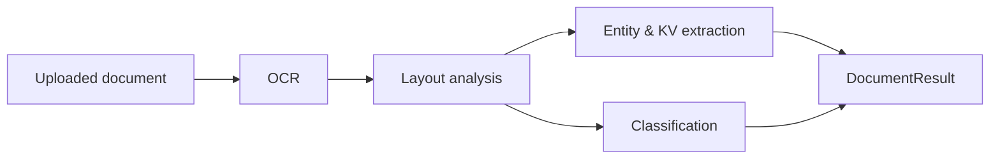

# Architecture

`document-intelligence-ai` is a FastAPI service that turns raw documents
(PDFs and images) into structured data. It is organized as a linear processing
pipeline with clearly separated, independently testable stages.

## Processing pipeline

1. **OCR** (`ocr.py`) — converts document bytes into text plus positioned
   tokens (bounding boxes + confidence). A Tesseract-backed engine is used in
   production; a deterministic, dependency-free fallback engine keeps the
   pipeline runnable everywhere (and in tests).
2. **Layout analysis** (`layout.py`) — groups tokens into lines/blocks using
   pure geometry over the bounding boxes. No external dependencies.
3. **Extraction** (`extraction.py`) — regex/heuristic extraction of dates,
   monetary amounts, emails, phone numbers, invoice numbers, and labelled
   key-value pairs.
4. **Classification** (`classification.py`) — keyword-scoring classifier that
   assigns a document type (invoice, contract, resume, receipt, report) with a
   normalized confidence.
5. **Aggregation** (`pipeline.py`) — `DocumentPipeline` orchestrates the stages
   and returns a single `DocumentResult`.

## Components

| Module                | Responsibility                                        |
| --------------------- | ----------------------------------------------------- |
| `config.py`           | Environment-driven settings (`DOCAI_*`).              |
| `logging_config.py`   | Structured logging setup.                             |
| `models.py`           | Pydantic models for all pipeline data.                |
| `ocr.py`              | OCR engine abstraction + fallback.                    |
| `layout.py`           | Geometric layout analysis.                            |
| `extraction.py`       | Entity and key-value extraction.                      |
| `classification.py`   | Document type classification.                         |
| `pipeline.py`         | End-to-end orchestration.                             |
| `main.py`             | FastAPI app and HTTP endpoints.                       |

## API surface

| Method | Path        | Description                              |
| ------ | ----------- | ---------------------------------------- |
| GET    | `/health`   | Liveness probe.                          |
| GET    | `/ready`    | Readiness probe.                         |
| POST   | `/process`  | Full pipeline over an uploaded document. |
| POST   | `/ocr`      | OCR only.                                |
| POST   | `/extract`  | OCR + extraction.                        |
| POST   | `/classify` | OCR + classification.                    |

## Design principles

- **Pure-Python core.** Layout, extraction, and classification depend only on
  the standard library, so they always work and are trivially testable.
- **Pluggable OCR.** Heavy OCR dependencies are optional and isolated behind
  the `OCREngine` interface.
- **Config over code.** Behavior is tuned through `DOCAI_*` environment
  variables surfaced by `Settings`.

## Deployment

The service ships a container image (see `Dockerfile`) and Terraform under
`infra/terraform/` provisioning ECR, an S3 bucket for uploaded documents,
CloudWatch logs, and a results-storage module. See the README for details.
